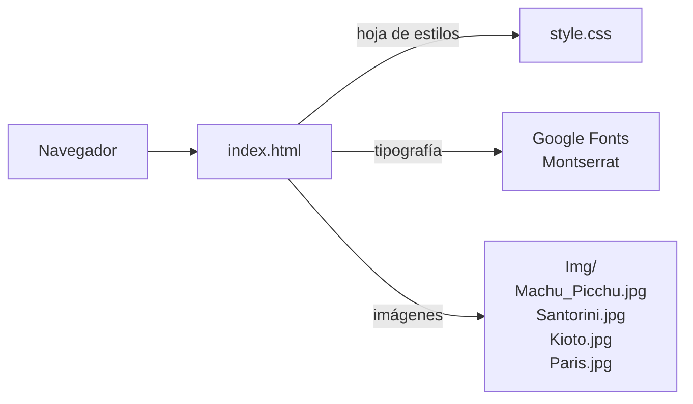
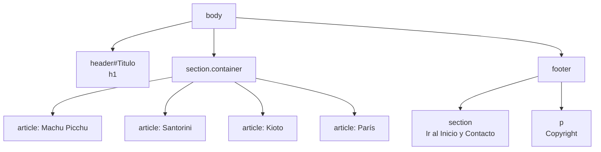

# Blog de Viajes


<!-- TODO: agregar badge de licencia cuando se defina -->

Sitio web estático, construido solo con HTML y CSS, que presenta un blog de viajes con cuatro destinos turísticos: Machu Picchu (Perú), Santorini (Grecia), Kioto (Japón) y París (Francia). Cada destino se muestra como una tarjeta con un resumen, una fotografía y una descripción ampliada.

---

## Tabla de contenidos

1. [Descripción y propósito](#descripción-y-propósito)
2. [Características principales](#características-principales)
3. [Vista previa](#vista-previa)
4. [Arquitectura](#arquitectura)
5. [Sistema de diseño](#sistema-de-diseño)
6. [Stack tecnológico](#stack-tecnológico)
7. [Estructura del proyecto](#estructura-del-proyecto)
8. [Requisitos previos](#requisitos-previos)
9. [Instalación y ejecución](#instalación-y-ejecución)
10. [Personalización](#personalización)
11. [Limitaciones conocidas](#limitaciones-conocidas)
12. [Roadmap](#roadmap)
13. [Guía de contribución](#guía-de-contribución)
14. [Créditos y licencia](#créditos-y-licencia)
15. [Autor](#autor)

---

## Descripción y propósito

El proyecto es una página de contenido que practica los fundamentos del desarrollo web: estructura semántica con HTML5, estilos con CSS, uso de tipografías externas, estados de enlaces e interacciones sencillas con transiciones. Su objetivo es presentar información turística de forma clara y ordenada, con una lectura cómoda de arriba hacia abajo.

**Público objetivo:** visitantes interesados en conocer destinos turísticos y estudiantes de desarrollo web que quieran revisar un ejemplo de maquetación sin frameworks.
<!-- TODO: confirmar público objetivo y, si aplica, agregar contexto académico (materia, institución, objetivos de aprendizaje). -->

## Características principales

- Cuatro artículos de destinos, cada uno con título, resumen, imagen y descripción ampliada.
- Encabezado con título principal y pie de página con enlaces de navegación y contacto.
- Enlace "Ir al Inicio" que regresa al encabezado mediante un ancla interna.
- Enlace de contacto con `mailto:`.
- Tarjetas con borde, fondo blanco y sombra animada al pasar el cursor.
- Tipografía Montserrat cargada desde Google Fonts.
- Estados diferenciados para enlaces (`link`, `visited`, `hover`, `active`).
- Sin JavaScript ni dependencias: se abre directamente en el navegador.

## Vista previa

<!-- TODO: agregar la captura en docs/img/ y ajustar el nombre de archivo. -->


---

## Arquitectura

### Visión general

Es un **sitio estático de una sola página**. El navegador recibe un único documento HTML que referencia una hoja de estilos local, una fuente externa y cuatro imágenes locales. No hay servidor, base de datos ni lógica de programación.

Principios de diseño observables en el código:

- **Separación de contenido y presentación:** la estructura vive en el HTML y toda la apariencia en `style.css`.
- **Estructura semántica:** uso de `header`, `section`, `article` y `footer` para dividir el documento.
- **Componente repetible:** cada destino es un `article` con la misma estructura interna (título, resumen, imagen, descripción).
- **Cero dependencias de compilación:** no requiere instaladores ni proceso de build.

### Diagrama de componentes



### Estructura del documento



### Estructura de cada artículo

| Elemento | Contenido |
|---|---|
| `h2` | Nombre del destino y país |
| `p` (primero) | Resumen breve |
| `img` | Fotografía del destino, ancho 400 px |
| `p` (segundo) | Descripción ampliada: historia, atractivos y recomendaciones |

### Decisiones técnicas clave

| Decisión | Justificación |
|---|---|
| HTML y CSS puros, sin frameworks | Mantiene el proyecto ligero y permite practicar los fundamentos. |
| Hoja de estilos externa | Separa contenido y presentación; facilita cambiar el diseño sin tocar el HTML. |
| Google Fonts (Montserrat) | Tipografía moderna sin necesidad de alojar archivos de fuente. |
| Contenedor centrado de ancho fijo | Produce una columna de lectura simple y consistente. |
| Transición de sombra en las tarjetas | Da retroalimentación visual al pasar el cursor sin usar JavaScript. |

### Seguridad, escalabilidad y rendimiento

- **Seguridad:** al ser estático y sin formularios ni scripts, la superficie de ataque es mínima. La única conexión externa es la carga de la fuente desde Google Fonts.
- **Escalabilidad:** agregar un destino implica copiar un bloque `article` y su imagen; para un volumen grande de contenido convendría un generador de sitios estáticos o un CMS.
- **Rendimiento:** las imágenes se cargan a su tamaño original y se reducen solo mediante el atributo `width`, por lo que conviene optimizarlas antes de publicar (ver [Roadmap](#roadmap)).

---

## Sistema de diseño

**Paleta de colores**

| Uso | Color |
|---|---|
| Fondo de la página | `#efefee` |
| Encabezado | `#364552` (texto blanco) |
| Tarjetas | `#fff` con borde negro de 1.5 px |
| Pie de página | `#222` (texto blanco) |
| Enlace al pasar el cursor | `red` |
| Enlace visitado | `gray` |
| Enlace activo | `blue` |

**Tipografía:** Montserrat, cargada con pesos variables (100 a 900) y estilos normal e itálico.

**Layout:** contenedor de 400 px centrado con `margin: 0 auto`; título principal de `4rem`; tarjetas con margen vertical de `1rem`.

---

## Stack tecnológico

| Tecnología | Rol |
|---|---|
| HTML5 | Estructura y contenido del documento |
| CSS3 | Estilos, transiciones y estados de enlaces |
| Google Fonts (Montserrat) | Tipografía |

## Estructura del proyecto

<!-- TODO: ajustar nombres de archivos y carpetas reales. -->

```
.
├── index.html           # Documento principal (estructura y contenido)
├── style.css            # Hoja de estilos
├── Img/
│   ├── Machu_Picchu.jpg
│   ├── Santorini.jpg
│   ├── Kioto.jpg
│   └── Paris.jpg
├── docs/
│   └── img/             # Capturas usadas en este README
└── README.md
```

## Requisitos previos

- Un navegador web moderno (Chrome, Firefox, Edge o Safari).
- Conexión a internet para cargar la tipografía de Google Fonts. Sin conexión, el sitio se muestra con la fuente de respaldo.
- Opcional: un editor de código como Visual Studio Code.

## Instalación y ejecución

No hay dependencias que instalar.

```bash
# 1. Clonar el repositorio
git clone https://github.com/Campriet03/<nombre-del-repositorio>.git   # TODO: reemplazar por la URL real
cd <nombre-del-repositorio>
```

**Opción A:** abrir `index.html` con doble clic en el navegador.  <!-- TODO: confirmar el nombre real del archivo -->

**Opción B:** usar la extensión *Live Server* de Visual Studio Code (clic derecho sobre `index.html` y *Open with Live Server*), que recarga la página automáticamente al guardar.

## Personalización

**Agregar un destino:** copie un bloque `article` completo dentro de `section.container`, cambie el título y los textos, y guarde la nueva imagen en `Img/`.

```html
<article class="post">
    <h2>Nombre del destino, País</h2>
    <p>Resumen breve.</p>
    
    <p>Descripción ampliada.</p>
</article>
```

**Cambiar colores:** edite los valores hexadecimales en `style.css` (`header`, `body`, `footer`).

**Cambiar la tipografía:** reemplace el enlace de Google Fonts en el `head` y actualice la regla `font-family` al inicio de `style.css`.

## Limitaciones conocidas

Estas son oportunidades de mejora del estado actual del código, documentadas para transparencia técnica:

**Accesibilidad y semántica**

- Las imágenes no tienen atributo `alt`, lo que impide que los lectores de pantalla las describan.
- El atributo `lang` del documento es `en`, pero el contenido está en español; debería ser `es`.
- El cuarto artículo (París) no incluye la clase `post`, a diferencia de los otros tres.

**Compatibilidad**

- Falta `<meta charset="UTF-8">` en el `head`; sin él, algunos navegadores o servidores pueden mostrar mal las tildes y la letra ñ.
- Falta `<meta name="viewport" content="width=device-width, initial-scale=1.0">`, por lo que en celulares la página no se adapta al ancho de la pantalla.
- El contenedor tiene ancho fijo de 400 px y las imágenes también, por lo que el diseño no es responsive y en pantallas grandes queda como una columna angosta.

**CSS**

- La propiedad `border-radius: 0.5 rem` tiene un espacio entre el número y la unidad, por lo que el navegador la ignora y las esquinas no se redondean. Debe escribirse `0.5rem`.
- La fuente de respaldo es `serif`; para Montserrat (sans-serif) corresponde `sans-serif`.
- Las tarjetas usan `cursor: pointer` pero no son clicables, lo que sugiere una interacción que no existe.
- El pie de página usa `float: right`, técnica que puede reemplazarse por Flexbox.

**Contenido**

- Los párrafos usan etiquetas `<br>` para forzar saltos de línea; es preferible dejar que el navegador ajuste el texto o dividir en varios párrafos.
- Algunos atributos `src` no llevan comillas (`src=Img/Paris.jpg` en tres artículos).

## Roadmap

<!-- TODO: confirmar cuáles de estas mejoras desea priorizar. -->

- [ ] Agregar `alt` a todas las imágenes y corregir `lang="es"`.
- [ ] Incluir `meta charset` y `meta viewport`.
- [ ] Diseño responsive con `max-width` y Flexbox o Grid.
- [ ] Corregir `border-radius` y la fuente de respaldo.
- [ ] Optimizar las imágenes (formato WebP y tamaños adecuados).
- [ ] Navegación entre destinos y botón de volver arriba.
- [ ] Modo oscuro.
- [ ] Publicación en GitHub Pages u otro hosting estático.

## Guía de contribución

<!-- TODO: ajustar al flujo real del proyecto. -->

1. Haga un *fork* del repositorio y cree una rama descriptiva:
   ```bash
   git checkout -b feat/nombre-de-la-mejora
   ```
2. Use mensajes de commit con el formato [Conventional Commits](https://www.conventionalcommits.org/es/) (`feat:`, `fix:`, `docs:`, `style:`).
3. Verifique que la página se visualiza correctamente en el navegador antes de enviar los cambios.
4. Abra un *Pull Request* describiendo qué cambia y por qué.

## Créditos y licencia

- **Imágenes:** <!-- TODO: indicar la fuente y licencia de cada fotografía (Machu Picchu, Santorini, Kioto, París). -->
- **Tipografía:** Montserrat, disponible en [Google Fonts](https://fonts.google.com/specimen/Montserrat).
- **Licencia del proyecto:** <!-- TODO: definir licencia (por ejemplo MIT) y agregar el archivo LICENSE. --> Pendiente de definir.

## Autor

**Camilo Alejandro Prieto Villarreal**
GitHub: [@Campriet03](https://github.com/Campriet03)
